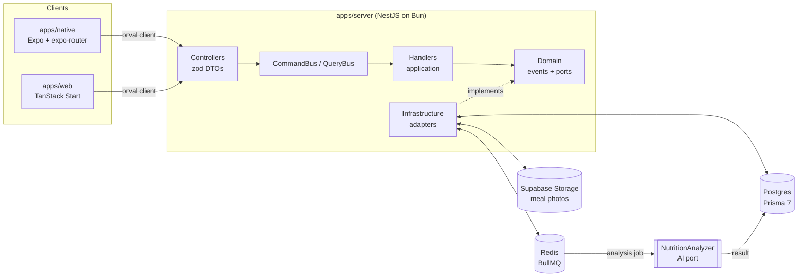

<picture>
  
</picture>

<h3 align="center">One photo. Your calories, macros and micros.</h3>

A web and mobile app that analyzes a photo of your meal with AI, estimates its nutritional content, suggests matching recipes and lets you share your meals with a community.

<a href="#features">Features</a> · <a href="#architecture">Architecture</a>

---

## About

Tracking what you eat usually means looking up every food in a database, weighing, typing, correcting… and giving up after three days.

**Calyx** starts from a simple idea:

> **The best food journal is the one you don't have to fill in.**

You take a photo of your meal. A background job queue hands the image to an AI analyzer, which returns an estimate of calories, macros and micronutrients. The result lands in the app, ready to feed your daily summary, your goals and a social feed.

{/* 🎬 PLACEHOLDER — Main demo video (30–90 s): meal photo → analysis → daily summary → feed */}

---

## ✨ Features

### 📸 Meal analysis from a photo

A dedicated camera tab, one shot, and the meal goes from "pending" to "ready" without blocking the UI. The analysis runs in the background, and the app reflects its state live.

<Screenshots
  items={[
    {
      light: '/assets/projects/calyx/app-light/01-camera.png',
      dark: '/assets/projects/calyx/app-dark/01-camera.png',
      alt: 'Photo capture',
      caption: 'Capture · built-in camera',
    },
  ]}
/>

---

### 🏠 Home & daily tracking

Calorie card, today's goal, weekly calendar and a list of recent meals: everything at a glance.

<Screenshots
  items={[
    {
      light: '/assets/projects/calyx/app-light/02-home.png',
      dark: '/assets/projects/calyx/app-dark/02-home.png',
      alt: 'Home screen',
      caption: 'Home · calories & recent meals',
    },
  ]}
/>

---

### 🖼️ Private media

Photos are uploaded to object storage behind a `STORAGE` port, then read back through time-limited **signed URLs**. No image is public by default.

---

### 🔐 Authentication

Accounts, sessions and routes protected by default with Better Auth: a global `AuthGuard`, and a `@Public()` decorator to explicitly open a route.

---

### 🍽️ Recipes & community _(work in progress)_

Recipe suggestions based on analyzed meals, and a social feed to share your plates. The data model is in place; the use cases come next.

---

## 🧱 Architecture

<Files>
  <Folder name="calyx" defaultOpen>
    <Folder name="apps" defaultOpen>
      <File name="server/ — NestJS API on Bun (CQRS, hexagonal architecture)" />
      <File name="web/ — TanStack Start web front end" />
      <File name="native/ — Expo SDK 58 mobile app + expo-router + Uniwind" />
    </Folder>
    <Folder name="packages" defaultOpen>
      <File name="db/ — Prisma 7 multi-file schema, migrations" />
      <File name="auth/ — Better Auth configuration" />
      <File name="contract/ — OpenAPI contract generated from the server" />
      <File name="api-client/ — TypeScript client generated by orval" />
      <File name="ui/ — Shared shadcn/ui components" />
      <File name="config/ — Shared TypeScript configuration" />
    </Folder>
    <File name="docker-compose.yml — Postgres and Redis for development" />
  </Folder>
</Files>

---

## 🧠 The server: a strict architecture

The most defining part of the project. Every API module follows the same layers, with verifiable dependency rules:

- **`interface` → `application` → `domain` ← `infrastructure`** — controllers only parse input and dispatch to the `CommandBus` or `QueryBus`. No business logic.
- **One handler per command or query** — small, testable, named by intent.
- **A dependency-free domain** — no Nest, Prisma or vendor SDKs. Ports are interfaces with an injection token, and adapters implement them in `infrastructure`.
- **Watertight modules** — a module never imports another module's services. Cross-context side effects go through **domain events**.
- **AI behind a port** — `NUTRITION_ANALYZER` lets a fake analyzer be plugged in for development and tests, then a real model without touching anything else.
- **An end-to-end contract** — zod DTOs produce the OpenAPI spec, committed and checked in CI, which in turn generates the client used by web and mobile.

---

## 🛠️ Tech stack

<TechStack
  groups={[
    { layer: 'Monorepo', items: ['Nx', 'Bun (workspaces)'] },
    {
      layer: 'Mobile',
      items: ['Expo SDK 58', 'expo-router', 'Uniwind', 'MMKV', 'jest-expo'],
    },
    {
      layer: 'Web',
      items: ['TanStack Start', 'React', 'Tailwind CSS', 'shadcn/ui'],
    },
    {
      layer: 'API',
      items: ['NestJS', 'Bun', 'CQRS (CommandBus / QueryBus)', 'Zod (nestjs-zod)', 'OpenAPI'],
    },
    { layer: 'Auth', items: ['Better Auth', 'Global AuthGuard'] },
    { layer: 'Database', items: ['PostgreSQL', 'Prisma 7 (multi-file schema)'] },
    { layer: 'Job queues', items: ['BullMQ', 'Redis'] },
    { layer: 'Storage', items: ['Supabase Storage', 'Signed URLs'] },
    { layer: 'API client', items: ['orval', 'Shared OpenAPI contract'] },
    {
      layer: 'Quality',
      items: ['Oxlint + Oxfmt', 'Jest', 'e2e tests on Bun', 'GitHub Actions'],
    },
    { layer: 'Config', items: ['Varlock', 'Typed .env.schema'] },
  ]}
/>

---

## 💡 What I learned

- **Keeping the domain clean.** Enforcing ports and adapters from day one costs a bit of ceremony, but it lets you swap the AI, the storage or the ORM without rewriting business logic.
- **Treating AI as a slow, fallible service.** An analysis isn't a synchronous request: a job queue, explicit states (pending, ready) and retries are needed for a smooth experience.
- **Making the contract the source of truth.** The server generates the OpenAPI spec, the spec generates the client, and CI fails if one drifts from the other: web and mobile can no longer fall out of sync unnoticed.
- **Making web and mobile coexist in a single repo.** Sharing auth, the client and configuration between TanStack Start and Expo demands discipline around dependencies and Metro config.

---

## 📸 Screenshots

<Screenshots
  items={[
    {
      light: '/assets/projects/calyx/app-light/03-meal-detail.png',
      dark: '/assets/projects/calyx/app-dark/03-meal-detail.png',
      alt: 'Analyzed meal detail',
      caption: 'Meal · macros & micros',
    },
    {
      light: '/assets/projects/calyx/app-light/04-week.png',
      dark: '/assets/projects/calyx/app-dark/04-week.png',
      alt: 'Weekly calendar',
      caption: 'Week · goal tracking',
    },
    {
      light: '/assets/projects/calyx/app-light/05-profile.png',
      dark: '/assets/projects/calyx/app-dark/05-profile.png',
      alt: 'Profile',
      caption: 'Profile · API status',
    },
  ]}
/>

---

## 🛣️ Roadmap

- [x] Authentication and protected routes
- [x] API health checks (liveness + readiness)
- [x] Prisma schema and migrations
- [x] Meal creation → analysis queue → "ready" status
- [x] Photo uploads and signed URLs
- [x] Mobile home screen (calories, recent meals)
- [x] OpenAPI contract and generated client, with drift check in CI
- [ ] Real nutrition analysis model (replacing the fake analyzer)
- [ ] Validate the storage adapter against a real bucket
- [ ] Recipe suggestions
- [ ] Community feed and meal sharing
- [ ] Web app: working screens
