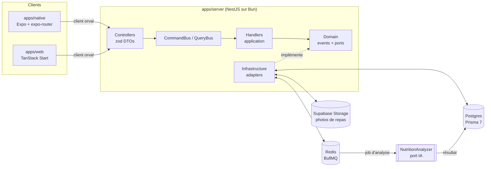

<picture>
  
</picture>

<h3 align="center">Une photo. Vos calories, vos macros, vos micros.</h3>

Une application web et mobile qui analyse la photo d'un repas avec l'IA, estime ses apports nutritionnels, propose des recettes adaptées et permet de partager ses repas avec une communauté.

<a href="#fonctionnalités">Fonctionnalités</a> · <a href="#architecture">Architecture</a>

---

## À propos

Suivre ce qu'on mange, c'est souvent chercher chaque aliment dans une base de données, peser, saisir, corriger… et abandonner au bout de trois jours.

**Calyx** part d'un constat simple :

> **Le meilleur journal alimentaire est celui qu'on n'a pas à remplir.**

Vous prenez votre repas en photo. Une file de tâches en arrière-plan confie l'image à un analyseur IA, qui renvoie une estimation des calories, des macros et des micronutriments. Le résultat arrive dans l'app, prêt à nourrir votre résumé du jour, vos objectifs et un fil social.

{/* 🎬 PLACEHOLDER — Vidéo de démo principale (30–90 s) : photo d'un repas → analyse → résumé du jour → fil */}

---

## ✨ Fonctionnalités

### 📸 Analyse de repas par photo

Un onglet caméra dédié, un cliché, et le repas passe de « en attente » à « prêt » sans bloquer l'interface. L'analyse tourne en tâche de fond, et l'app reflète son état en direct.

<Screenshots
  items={[
    {
      light: '/assets/projects/calyx/app-light/01-camera.png',
      dark: '/assets/projects/calyx/app-dark/01-camera.png',
      alt: 'Capture photo',
      caption: 'Capture · caméra intégrée',
    },
  ]}
/>

---

### 🏠 Accueil & suivi du jour

Carte de calories, objectif du jour, calendrier de la semaine et liste des repas récents : tout ce qu'il faut en un coup d'œil.

<Screenshots
  items={[
    {
      light: '/assets/projects/calyx/app-light/02-home.png',
      dark: '/assets/projects/calyx/app-dark/02-home.png',
      alt: "Écran d'accueil",
      caption: 'Accueil · calories & repas récents',
    },
  ]}
/>

---

### 🖼️ Médias privés

Les photos sont envoyées vers un stockage objet derrière un port `STORAGE`, puis relues via des **URLs signées** à durée limitée. Aucune image n'est publique par défaut.

---

### 🔐 Authentification

Comptes, sessions et routes protégées par défaut avec Better Auth : un `AuthGuard` global, et un décorateur `@Public()` pour ouvrir explicitement une route.

---

### 🍽️ Recettes & communauté _(en construction)_

Suggestions de recettes à partir des repas analysés, et fil social pour partager ses assiettes. Le modèle de données est en place ; les cas d'usage arrivent ensuite.

---

## 🧱 Architecture

<Files>
  <Folder name="calyx" defaultOpen>
    <Folder name="apps" defaultOpen>
      <File name="server/ — API NestJS sur Bun (CQRS, architecture hexagonale)" />
      <File name="web/ — Front web TanStack Start" />
      <File name="native/ — App mobile Expo SDK 58 + expo-router + Uniwind" />
    </Folder>
    <Folder name="packages" defaultOpen>
      <File name="db/ — Schéma Prisma 7 multi-fichiers, migrations" />
      <File name="auth/ — Configuration Better Auth" />
      <File name="contract/ — Contrat OpenAPI généré depuis le serveur" />
      <File name="api-client/ — Client TypeScript généré par orval" />
      <File name="ui/ — Composants shadcn/ui partagés" />
      <File name="config/ — Configuration TypeScript partagée" />
    </Folder>
    <File name="docker-compose.yml — Postgres et Redis pour le développement" />
  </Folder>
</Files>

---

## 🧠 Le serveur : une architecture stricte

La partie la plus structurante du projet. Chaque module de l'API suit les mêmes couches, avec des règles de dépendance vérifiables :

- **`interface` → `application` → `domain` ← `infrastructure`** — les contrôleurs se contentent de parser l'entrée et de dispatcher vers le `CommandBus` ou le `QueryBus`. Aucune logique métier.
- **Un handler par commande ou requête** — petit, testable, nommé par intention.
- **Un domaine sans dépendance** — pas de Nest, de Prisma ni de SDK tiers. Les ports sont des interfaces avec un token d'injection, et les adapters les implémentent côté `infrastructure`.
- **Des modules étanches** — un module n'importe jamais les services d'un autre. Les effets de bord entre contextes passent par des **événements de domaine**.
- **L'IA derrière un port** — `NUTRITION_ANALYZER` permet de brancher un faux analyseur en développement et en test, puis un vrai modèle sans toucher au reste.
- **Un contrat de bout en bout** — les DTO zod produisent l'OpenAPI, committé et vérifié en CI, qui génère à son tour le client utilisé par le web et le mobile.

---

## 🛠️ Stack technique

<TechStack
  groups={[
    { layer: 'Monorepo', items: ['Nx', 'Bun (workspaces)'] },
    {
      layer: 'Mobile',
      items: ['Expo SDK 58', 'expo-router', 'Uniwind', 'MMKV', 'jest-expo'],
    },
    {
      layer: 'Web',
      items: ['TanStack Start', 'React', 'Tailwind CSS', 'shadcn/ui'],
    },
    {
      layer: 'API',
      items: ['NestJS', 'Bun', 'CQRS (CommandBus / QueryBus)', 'Zod (nestjs-zod)', 'OpenAPI'],
    },
    { layer: 'Auth', items: ['Better Auth', 'AuthGuard global'] },
    { layer: 'Base de données', items: ['PostgreSQL', 'Prisma 7 (schéma multi-fichiers)'] },
    { layer: 'Files de tâches', items: ['BullMQ', 'Redis'] },
    { layer: 'Stockage', items: ['Supabase Storage', 'URLs signées'] },
    { layer: 'Client API', items: ['orval', 'Contrat OpenAPI partagé'] },
    {
      layer: 'Qualité',
      items: ['Oxlint + Oxfmt', 'Jest', 'Tests e2e sous Bun', 'GitHub Actions'],
    },
    { layer: 'Config', items: ['Varlock', '.env.schema typé'] },
  ]}
/>

---

## 💡 Ce que j'en retiens

- **Garder le domaine propre.** Imposer des ports et des adapters dès le début coûte un peu de cérémonie, mais permet de remplacer l'IA, le stockage ou l'ORM sans réécrire la logique métier.
- **Traiter l'IA comme un service lent et faillible.** Une analyse n'est pas une requête synchrone : file de tâches, états explicites (en attente, prêt) et reprise sont nécessaires pour une expérience fluide.
- **Faire du contrat la source de vérité.** Le serveur génère l'OpenAPI, l'OpenAPI génère le client, et la CI échoue si l'un dérive de l'autre : web et mobile ne peuvent plus se désynchroniser sans que ça se voie.
- **Faire cohabiter web et mobile dans un seul dépôt.** Partager l'auth, le client et la configuration entre TanStack Start et Expo demande de la rigueur sur les dépendances et la config Metro.

---

## 📸 Captures d'écran

<Screenshots
  items={[
    {
      light: '/assets/projects/calyx/app-light/03-meal-detail.png',
      dark: '/assets/projects/calyx/app-dark/03-meal-detail.png',
      alt: "Détail d'un repas analysé",
      caption: 'Repas · macros & micros',
    },
    {
      light: '/assets/projects/calyx/app-light/04-week.png',
      dark: '/assets/projects/calyx/app-dark/04-week.png',
      alt: 'Calendrier de la semaine',
      caption: 'Semaine · suivi des objectifs',
    },
    {
      light: '/assets/projects/calyx/app-light/05-profile.png',
      dark: '/assets/projects/calyx/app-dark/05-profile.png',
      alt: 'Profil',
      caption: 'Profil · état de l’API',
    },
  ]}
/>

---

## 🛣️ Roadmap

- [x] Authentification et routes protégées
- [x] Santé de l'API (liveness + readiness)
- [x] Schéma Prisma et migrations
- [x] Création d'un repas → file d'analyse → statut « prêt »
- [x] Envoi des photos et URLs signées
- [x] Écran d'accueil mobile (calories, repas récents)
- [x] Contrat OpenAPI et client généré, avec contrôle de dérive en CI
- [ ] Vrai modèle d'analyse nutritionnelle (à la place de l'analyseur factice)
- [ ] Validation de l'adaptateur de stockage sur un vrai bucket
- [ ] Recettes suggérées
- [ ] Fil communautaire et partage de repas
- [ ] Application web : écrans fonctionnels
