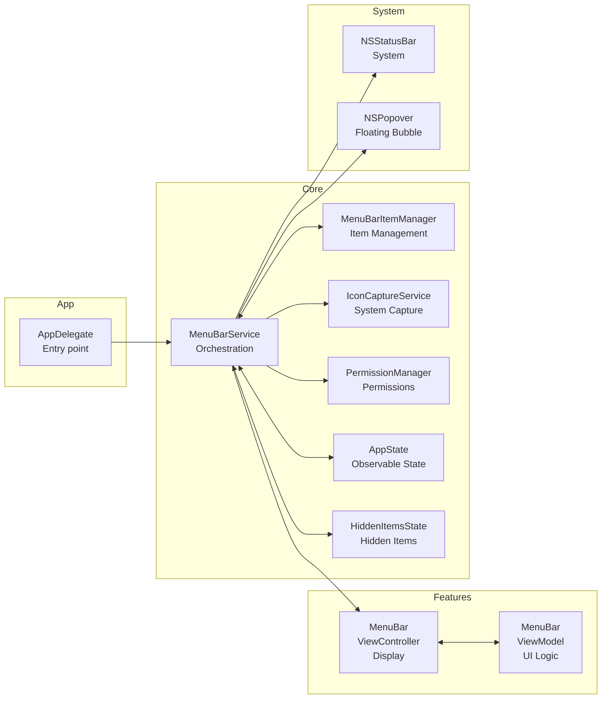

<picture>
  <source
    media="(prefers-color-scheme: dark)"
    srcset="/assets/projects/whoa-bar/banners/github-readme-dark.png"
  />
  
</picture>

<h3 align="center">A menu bar without compromise.</h3>

An ultra-lightweight macOS application that integrates fully into the system menu bar: no Dock icon, no external dependencies, just pure Swift and rigorous architecture.

<a href="#features">Features</a> · <a href="#architecture">Architecture</a> ·
<a href="#tech-stack">Stack</a>

---

## About

The macOS menu bar fills up quickly. Applications add their icons, and then it's chaos: no organization, no way to hide them without uninstalling, and zero system integration.

**Whoa Bar** proposes a different philosophy:

> **A menu bar should be an extension of the system, not a mess.**

The app roots itself in the system menu bar, never appearing in the Dock (LSUIElement mode). It offers simple state control, manages hidden icons via an elegant floating bubble, and features architecture clear enough to evolve without technical debt.

---

## ✨ Features

### 🟢 Status at a Click

The menu bar icon displays the current state (🟢 active / 🔴 inactive). One click toggles the state and instantly reflects the change. Perfect for quickly muting background services.

---

### 💬 Hidden Icons Bubble

When the menu bar overflows, excess icons are neatly tucked into a **scrollable floating bubble**. It appears on hover or click, displays the 10 hidden items in a clean grid, and disappears discreetly when you look away.

<Screenshots
  items={[
    {
      light: '/assets/projects/whoa-bar/app-light/01-hidden-bubble.png',
      dark: '/assets/projects/whoa-bar/app-dark/01-hidden-bubble.png',
      alt: 'Hidden icons bubble',
      caption: 'Menu bar · hidden icons in floating bubble',
    },
  ]}
/>

---

### ⚡ Icon Capture

An internal service captures icons directly from the system menu bar in real time, allowing accurate display of what's actually there — without relying on a pre-configured app database.

---

### 🔒 Native System Integration

The app requests necessary permissions via `PermissionManager` and roots itself in AppKit without detours. No third-party frameworks, no unnecessary abstraction: pure Swift that macOS recognizes immediately.

---

## 🧱 Architecture



---

### Layers and Responsibilities

- **App**: Entry point, delegate (accessory mode initialization)
- **Features**: Screens and business logic (ViewController + ViewModel)
- **Core/Services**: Stateless orchestration, system capture, permissions
- **Core/Models**: Observable state (AppState, HiddenItemsState)
- **Core/UI**: Reusable components (HiddenItemsBubbleViewController)
- **System**: AppKit integration (NSStatusBar, NSPopover)

### Architectural Principles

- **Zero external dependencies**: Swift + AppKit only. No CocoaPods, no third-party SPM. Just the macOS framework.
- **Stateless services**: MenuBarService orchestrates but doesn't store business state. State lives in ObservableObject models.
- **Isolated UI layer**: ViewControllers talk to ViewModels, never directly to Services.
- **Combine from day one**: Declarative reactivity, easy to test.
- **One file = one responsibility**: 13 files, 13 clear concepts.

---

## 🛠️ Tech Stack

<TechStack
  groups={[
    { layer: 'System', items: ['macOS 13.0+', 'Xcode 15.0+', 'Swift 5.9'] },
    {
      layer: 'Framework',
      items: ['AppKit', 'Combine', 'Foundation'],
    },
    {
      layer: 'Services',
      items: ['IconCaptureService (CGWindowList)', 'PermissionManager (NSWorkspace)'],
    },
    {
      layer: 'Architecture',
      items: ['MVVM (ViewController + ViewModel)', 'Observable Objects', 'Feature-based folders'],
    },
    {
      layer: 'Testing',
      items: ['Unit Tests', 'UI Tests', 'Swift Package Manager'],
    },
    {
      layer: 'Config',
      items: ['LSUIElement = true (menu bar only)', 'No Dock icon', 'Basic Entitlements'],
    },
  ]}
/>

---

## 💡 Key Takeaways

- **Constraints are design.** No dependencies, no Dock: these imposed limits forced writing minimal, testable, and understandable code. A Service does its job, a ViewController displays, a ViewModel binds the two.
- **AppKit hasn't lost anything.** From afar it looks legacy; used correctly (NSPopover for the bubble, NSStatusBar for anchoring), it's a stable and powerful API.
- **Combine makes all the difference.** Without it, we'd be forced to pass callbacks everywhere. With it, reactive state flows naturally: a @Published changes, and the UI repaints.
- **The menu bar is a context.** The app has one responsibility: augment the existing bar. No global preferences, no floating windows, no iCloud sync. Just: display, update, listen to clicks.

---

## 🗂️ Project Structure

<Files>
  <Folder name="whoa-bar" defaultOpen>
    <Folder name="Sources" defaultOpen>
      <Folder name="App">
        <File name="AppDelegate.swift — Initialization, accessory mode" />
      </Folder>
      <Folder name="Features/MenuBar" defaultOpen>
        <File name="MenuBarViewController.swift — Display & UI interactions" />
        <File name="MenuBarViewModel.swift — Business logic & state binding" />
      </Folder>
      <Folder name="Core" defaultOpen>
        <Folder name="Services">
          <File name="MenuBarService.swift — Component orchestration" />
          <File name="MenuBarItemManager.swift — Item & bubble management" />
          <File name="IconCaptureService.swift — System icon capture" />
          <File name="PermissionManager.swift — Permission requests" />
        </Folder>
        <Folder name="Models">
          <File name="AppState.swift — Observable state (active/inactive)" />
          <File name="MenuBarItemData.swift — Item model" />
          <File name="HiddenItemsState.swift — Hidden items state" />
        </Folder>
        <Folder name="UI">
          <File name="HiddenItemsBubbleViewController.swift — Floating bubble" />
          <File name="MenuBarItemView.swift — Reusable item view" />
        </Folder>
        <Folder name="Utilities">
          <File name="Constants.swift — Dimensions, spacing, colors" />
        </Folder>
      </Folder>
    </Folder>
    <Folder name="Resources">
      <File name="Info.plist — LSUIElement=true, metadata" />
      <File name="WhooBar.entitlements — Sandbox permissions" />
    </Folder>
    <Folder name="Tests">
      <File name="Unit/ — Unit tests (Services, Models)" />
      <File name="UI/ — UI tests (ViewControllers, interactions)" />
    </Folder>
    <File name="Package.swift — Swift Package manifest" />
  </Folder>
</Files>

---

## 🛣️ Roadmap

- [x] Accessory mode initialization (no Dock)
- [x] Menu bar with status icon (🟢 / 🔴)
- [x] Observable state toggle
- [x] System icon capture
- [x] Floating bubble for hidden items
- [x] MVVM architecture + Services
- [x] Unit and UI tests
- [ ] System services integration (Bluetooth, WiFi, Battery)
- [ ] Keyboard shortcuts (Cmd+B to toggle)
- [ ] Native dark mode
- [ ] Layout settings (groups, order) in UserDefaults
- [ ] Distribution via macOS App Store

---

## 🚀 Getting Started

### Prerequisites

- macOS 13.0+
- Xcode 15.0+ (or Swift 5.9 CLI)

### Build

```bash
# With Swift Package Manager
swift build

# Or: generate Xcode project
swift package generate-xcodeproj
open WhooBar.xcodeproj
```

### Run

```bash
# CLI
swift run WhooBar

# Or: Xcode → select "WhooBar" + Cmd+R
```

### Tests

```bash
# All tests
swift test

# Unit tests only
swift test --filter WhooBarUnitTests

# UI tests only
swift test --filter WhooBarUITests
```

---

## 📝 Development Notes

- **One type per file**: Each class, struct, enum in its own file for clarity.
- **Zero dependencies**: Pure Swift/AppKit. No CocoaPods, no external SPM.
- **Testable by default**: Core logic in Services/Models, easy to test without UI.
- **Strict layers**: Features → Core → System. No upward crossing.
- **Idiomatic AppKit**: We use NSPopover, NSStatusBar, NSViewController the way macOS intends.

---

## 📄 License

MIT
