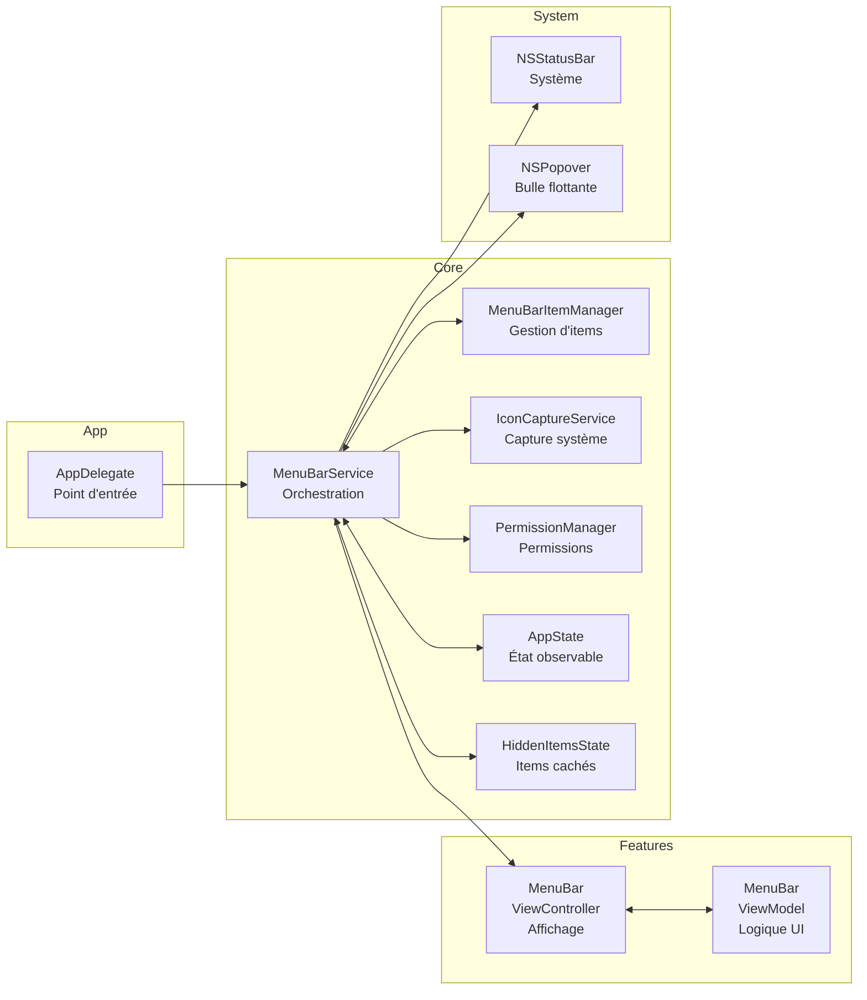

<picture>
  
</picture>

<h3 align="center">Une barre de menu sans compromis.</h3>

Une application macOS ultra-légère qui s'intègre complètement à la barre de menu système : sans icône Dock, sans dépendances externes, juste Swift pur et une architecture rigoureuse.

<a href="#fonctionnalités">Fonctionnalités</a> · <a href="#architecture">Architecture</a> ·
<a href="#stack-technique">Stack</a>

---

## À propos

La barre de menu macOS se remplit vite. Les applications y ajoutent leurs icônes, puis c'est le chaos : aucune organisation, aucun moyen de les masquer sans les désinstaller, et zéro intégration avec le système.

**Whoa Bar** propose une philosophie différente :

> **Une barre de menu devrait être une extension du système, pas un capharnaüm.**

L'app s'enracine dans le menu bar system, sans jamais apparaître au Dock (LSUIElement mode). Elle offre un contrôle d'état simple, une gestion des icônes cachées via une bulle flottante élégante, et une architecture suffisamment claire pour évoluer sans dette technique.

---

## ✨ Fonctionnalités

### 🟢 Statut à un clic

L'icône de la barre de menu affiche l'état actuel (🟢 actif / 🔴 inactif). Un clic bascule l'état et reflète instantanément le changement. Parfait pour muter rapidement des services en arrière-plan.

---

### 💬 Bulle des icônes cachées

Quand la barre de menu déborde, les icônes excédentaires se rangent dans une **bulle flottante scrollable**. Elle apparaît au survol ou au clic, affiche les 10 éléments masqués dans une grille propre, et disparaît discrètement dès qu'on regarde ailleurs.

<Screenshots
  items={[
    {
      light: '/assets/projects/whoa-bar/banners/square-post.png',
      dark: '/assets/projects/whoa-bar/banners/square-post.png',
      alt: 'Bulle des icônes cachées',
      caption: 'Menu bar · icônes cachées en bulle flottante',
    },
  ]}
/>

---

### ⚡ Capture des icônes

Un service interne capture les icônes directement depuis la barre de menu système en temps réel, permettant d'afficher fidèlement ce qui s'y trouve — sans dépendre d'une base de données d'apps pré-configured.

---

### 🔒 Intégration système native

L'app demande les permissions nécessaires via `PermissionManager` et s'enracine dans AppKit sans détour. Pas de frameworks tiers, pas d'abstraction inutile : du Swift pur que macOS reconnaît immédiatement.

---

## 🧱 Architecture



---

### Couches et responsabilités

- **App**: Point d'entrée, délégué (initialisation en mode accessory)
- **Features**: Écrans et logique métier (ViewController + ViewModel)
- **Core/Services**: Orchestration sans état, capture système, permissions
- **Core/Models**: État observable (AppState, HiddenItemsState)
- **Core/UI**: Composants réutilisables (HiddenItemsBubbleViewController)
- **System**: Intégration AppKit (NSStatusBar, NSPopover)

### Principes architecturaux

- **Pas de dépendances externes**: Swift + AppKit. Zéro Cocoapod, zéro SPM tiers. Juste le framework macOS.
- **Services stateless**: MenuBarService orchestre mais ne stocke pas d'état métier. L'état vit dans les modèles ObservableObject.
- **Couche UI isolée**: Les ViewControllers parlent aux ViewModels, jamais directement aux Services.
- **Combine dès le début**: Réactivité déclarative, facile à tester.
- **Un fichier = une responsabilité**: 13 fichiers, 13 concepts clairs.

---

## 🛠️ Stack technique

<TechStack
  groups={[
    { layer: 'Système', items: ['macOS 13.0+', 'Xcode 15.0+', 'Swift 5.9'] },
    {
      layer: 'Framework',
      items: ['AppKit', 'Combine', 'Foundation'],
    },
    {
      layer: 'Services',
      items: ['IconCaptureService (CGWindowList)', 'PermissionManager (NSWorkspace)'],
    },
    {
      layer: 'Architecture',
      items: ['MVVM (ViewController + ViewModel)', 'Observable Objects', 'Feature-based folders'],
    },
    {
      layer: 'Testing',
      items: ['Unit Tests', 'UI Tests', 'Swift Package Manager'],
    },
    {
      layer: 'Config',
      items: ['LSUIElement = true (menu bar only)', 'No Dock icon', 'Entitlements basiques'],
    },
  ]}
/>

---

## 💡 Ce que j'en retiens

- **Les constraints, c'est du design.** Pas de dépendances, pas de Dock : ces limites imposées ont forcé à écrire du code minimaliste, testable et compréhensible. Un Service fait son truc, un ViewController affiche, un ViewModel lie les deux.
- **AppKit n'a rien perdu.** Vu de loin, c'est du legacy ; utilisé correctement (NSPopover pour la bulle, NSStatusBar pour l'ancrage), c'est une API stable et puissante.
- **Combine rachète beaucoup.** Sans elle, on serait forcé de passer des callbacks partout. Avec elle, l'état réactif coule simplement : un @Published change, et l'UI se repeint.
- **La barre de menu, c'est un contexte.** L'app n'a qu'une seule responsabilité : augmenter la barre existante. Pas de préférences globales, pas de fenêtres flottantes, pas de synchro iCloud. Juste : afficher, mettre à jour, écouter les clics.

---

## 🗂️ Structure du projet

<Files>
  <Folder name="whoa-bar" defaultOpen>
    <Folder name="Sources" defaultOpen>
      <Folder name="App">
        <File name="AppDelegate.swift — Initialisation, mode accessory" />
      </Folder>
      <Folder name="Features/MenuBar" defaultOpen>
        <File name="MenuBarViewController.swift — Affichage & interactions UI" />
        <File name="MenuBarViewModel.swift — Logique métier & state binding" />
      </Folder>
      <Folder name="Core" defaultOpen>
        <Folder name="Services">
          <File name="MenuBarService.swift — Orchestration des composants" />
          <File name="MenuBarItemManager.swift — Gestion des items & bulle" />
          <File name="IconCaptureService.swift — Capture système des icônes" />
          <File name="PermissionManager.swift — Demandes de permissions" />
        </Folder>
        <Folder name="Models">
          <File name="AppState.swift — État observable (actif/inactif)" />
          <File name="MenuBarItemData.swift — Modèle d'item" />
          <File name="HiddenItemsState.swift — État des items cachés" />
        </Folder>
        <Folder name="UI">
          <File name="HiddenItemsBubbleViewController.swift — Bulle flottante" />
          <File name="MenuBarItemView.swift — Vue réutilisable d'item" />
        </Folder>
        <Folder name="Utilities">
          <File name="Constants.swift — Dimensions, spacing, couleurs" />
        </Folder>
      </Folder>
    </Folder>
    <Folder name="Resources">
      <File name="Info.plist — LSUIElement=true, métadonnées" />
      <File name="WhooBar.entitlements — Permissions sandbox" />
    </Folder>
    <Folder name="Tests">
      <File name="Unit/ — Tests unitaires (Services, Models)" />
      <File name="UI/ — Tests UI (ViewControllers, interactions)" />
    </Folder>
    <File name="Package.swift — Manifeste Swift Package" />
  </Folder>
</Files>

---

## 🛣️ Roadmap

- [x] Initialisation en mode accessory (pas de Dock)
- [x] Barre de menu avec icône de statut (🟢 / 🔴)
- [x] État toggle observable
- [x] Capture des icônes système
- [x] Bulle flottante pour items cachés
- [x] Architecture MVVM + Services
- [x] Tests unitaires et UI
- [ ] Raccourcis clavier (Cmd+B pour toggle)
- [ ] Distribution via App Store macOS

---

## 🚀 Démarrer

### Prérequis

- macOS 13.0+
- Xcode 15.0+ (ou Swift 5.9 CLI)

### Build

```bash
# Avec Swift Package Manager
swift build

# Ou : générer le projet Xcode
swift package generate-xcodeproj
open WhooBar.xcodeproj
```

### Run

```bash
# CLI
swift run WhooBar

# Ou : Xcode → sélectionner "WhooBar" + Cmd+R
```

### Tests

```bash
# Tous les tests
swift test

# Unitaires uniquement
swift test --filter WhooBarUnitTests

# UI uniquement
swift test --filter WhooBarUITests
```

---

## 📝 Notes de développement

- **Un type par fichier**: Chaque classe, struct, enum dans son propre fichier pour la clarté.
- **Pas de dépendances**: Pure Swift/AppKit. Zéro CocoaPods, zéro SPM externes.
- **Testable par défaut**: Core logic en Services/Models, facile à tester sans UI.
- **Couches strictes**: Features → Core → System. Pas de remontée.
- **AppKit idiomatique**: On utilise NSPopover, NSStatusBar, NSViewController comme macOS les entend.

---

## 📄 Licence

MIT
