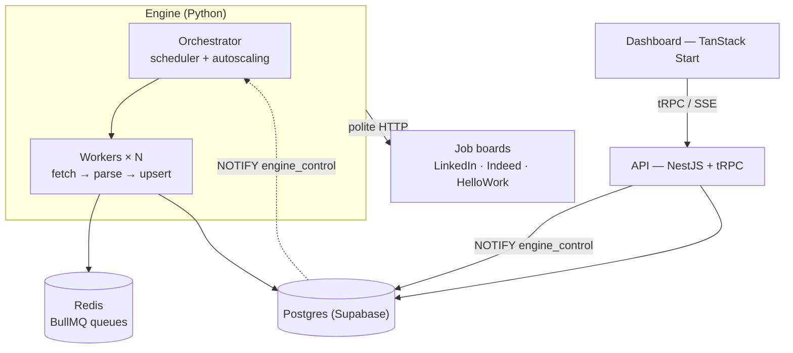

{/* 🖼️ PLACEHOLDER — Project logo (~96px) */}

<h3 align="center">Every job offer, one dashboard.</h3>

A full-stack platform that collects work-study and full-time job postings from several job boards, deduplicates them and lets you track and apply from a single place.

<a href="#features">Features</a> · <a href="#architecture">Architecture</a>

---

## About

Looking for a work-study position or a first job means checking LinkedIn, Indeed, HelloWork and others every day, finding the same offer three times and losing track of where you applied.

**Whoa Jobs** fixes that with one idea:

> **The job boards come to you, not the other way around.**

A Python ingestion engine collects postings in the background, an API normalizes and serves them, and a dashboard lets candidates browse, filter and apply — while admins steer the whole engine live, without ever restarting it.

{/* 🎬 PLACEHOLDER — Main demo video (30–90 s): sign in → job list → filters → auto-apply */}

---

## ✨ Features

### 🔎 Aggregated job feed

Every source in a single list, with search and filters by source, location, contract type and date.

When the same offer appears on several sites, it is **grouped across sources** instead of showing up three times.

<Screenshots
  items={[
    {
      light: '/assets/projects/whoa-jobs/app-light/04-jobs.png',
      dark: '/assets/projects/whoa-jobs/app-dark/04-jobs.png',
      alt: 'Job list',
      caption: 'Unified feed · search & filters',
    },
  ]}
/>

---

### 📄 Documents

Upload your CV and cover letter once. They are stored in a private bucket and previewed directly in the sidebar (PDF and DOCX).

<Screenshots
  items={[
    {
      light: '/assets/projects/whoa-jobs/app-light/05-documents.png',
      dark: '/assets/projects/whoa-jobs/app-dark/05-documents.png',
      alt: 'Documents',
      caption: 'Documents · CV & cover letter',
    },
  ]}
/>

---

### 🚀 Auto-apply

One click resolves where the offer takes applications, checks your documents and sends them — with an atomic guard so the same application can never be sent twice, and retry on failure.

{/* 🎬 PLACEHOLDER — Short GIF (≤ 15 s): click on "Auto-apply" and the status changing */}

---

### 🔔 Real-time notifications

Notifications stream to the dashboard over SSE as soon as they are committed in Postgres (`LISTEN/NOTIFY`), with importance levels and read state.

---

### 🏢 Workspaces & teams

Companies, invitations, teams, member roles and custom branding — built on Better Auth organizations.

---

### 🎛️ Engine control room

Super admins get a full control room for the ingestion engine:

- **Live ops** — queue depth, active vs. target workers, requests per minute, error rate, circuit-breaker state
- **Hot settings** — enable the engine or a single source, "Run now", tune rate limits and scaling, all applied **within seconds, without a restart**
- **Cron jobs & logs** — schedules and events backed by real engine data
- **Audit, impersonation & broadcast** — every sensitive action traced, "view as" a user, notify everyone

<Screenshots
  items={[
    {
      light: '/assets/projects/whoa-jobs/app-light/02-system-status.png',
      dark: '/assets/projects/whoa-jobs/app-dark/02-system-status.png',
      alt: 'System status',
      caption: 'Control room · system status',
    },
  ]}
/>

{/* 🎬 PLACEHOLDER — Short GIF: enable a driver, "Run now", queues filling up in Live ops */}

<Screenshots
  items={[
    {
      light: '/assets/projects/whoa-jobs/engine-run-now.gif',
      dark: '/assets/projects/whoa-jobs/engine-run-now.gif',
      alt: 'Run now from the dashboard',
      caption: 'Run now from the dashboard',
    },
  ]}
/>

---

## 🧱 Architecture

The project is an **Nx monorepo** mixing TypeScript (Bun) and Python (uv):

<Files>
  <Folder name="whoa-jobs" defaultOpen>
    <Folder name="apps" defaultOpen>
      <File name="dashboard/ — TanStack Start front end (port 3001)" />
      <File name="server/ — NestJS API serving packages/api (port 3000)" />
      <File name="cockpit/ — Separate platform-operations UI (port 3003 in dev)" />
      <File name="cockpit-api/ — Cockpit auth and operations API (port 3002 in dev)" />
      <File name="engine/ — Python ingestion engine (BullMQ + Redis)" />
      <File name="fumadocs/ — Product docs, releases and content APIs (port 4000)" />
    </Folder>
    <Folder name="packages" defaultOpen>
      <File name="api/ — tRPC routers, middlewares, Zod schemas, business logic" />
      <File name="auth/ — Better Auth configuration" />
      <File name="db/ — Prisma schema, migrations, seeds, Supabase config" />
      <File name="shared/ — Shared contracts and server utilities" />
      <File name="ui/ — Shared shadcn/ui components + global styles" />
      <File name="config/ — Shared base tsconfig" />
    </Folder>
    <Folder name="deploy/cockpit/">
      <File name="Cockpit proxy, Redis ACL and verification" />
    </Folder>
    <File name="docker-compose.yml — User-facing app, Redis and engine" />
    <File name="docker-compose.cockpit.yml — Hardened Cockpit, engine and tunnel stack" />
    <File name="docker-compose.local.yml — Optional Caddy proxy (HTTPS on *.whoa-jobs.localtest.me)" />
    <File name="Caddyfile" />
  </Folder>
</Files>

---

## 🕷️ The ingestion engine

The most interesting part of the project. It is a **horizontally scalable** collector designed to be **polite by construction**:

- **Task queues on Redis (BullMQ)** — one task = one search or one posting. At-least-once delivery, idempotent upserts, deduplication keys: a replayed task never creates a duplicate.
- **Autoscaling** — the orchestrator sizes the worker pool from queue depth, as local processes, Docker containers or fixed replicas.
- **One shared polite client** — `robots.txt`, a global token bucket hard-capped at 2 req/s, per-domain concurrency, a circuit breaker shared by every worker, exponential backoff with jitter, honest User-Agent.
- **No evasion, ever** — no proxy rotation, no fingerprint spoofing, no CAPTCHA solving. A blocked source is **paused** and surfaced in the dashboard, never worked around.
- **Raw pages kept** — parsers can be re-run on everything already downloaded without a single network request.
- **Live configuration** — runtime settings validated against a single JSON spec on both sides (API and engine), reloaded through Postgres `NOTIFY`.

---

## 🛠️ Tech stack

<TechStack
  groups={[
    { layer: 'Monorepo', items: ['Nx 23', 'Bun 1.4 (workspaces + catalog)', 'uv (Python)'] },
    {
      layer: 'Dashboard',
      items: [
        'TanStack Start',
        'TanStack Router',
        'TanStack Query',
        'TanStack Form',
        'TanStack Table',
        'React 19',
        'Tailwind CSS 4',
        'shadcn/ui',
        'Motion',
        'Recharts',
      ],
    },
    { layer: 'API', items: ['NestJS 11', 'tRPC 11 (nestjs-trpc)', 'Zod 4', 'evlog'] },
    {
      layer: 'Cockpit',
      items: ['TanStack Start (front end)', 'NestJS + tRPC API', 'Platform operations'],
    },
    {
      layer: 'Auth',
      items: ['Better Auth', 'Organizations', 'Teams', 'Admin', 'Impersonation'],
    },
    {
      layer: 'Database',
      items: ['PostgreSQL (Supabase)', 'Prisma (multi-file schema)', 'public & engine schemas'],
    },
    { layer: 'Storage', items: ['Supabase Storage', 'Private user-documents bucket'] },
    {
      layer: 'Ingestion engine',
      items: [
        'Python 3.12',
        'BullMQ',
        'Redis',
        'httpx',
        'SQLAlchemy (async)',
        'BeautifulSoup / lxml',
        'Typer',
        'Pydantic',
      ],
    },
    { layer: 'Documentation', items: ['Fumadocs (Next.js)'] },
    {
      layer: 'Quality',
      items: [
        'Oxlint + Oxfmt',
        'Husky + lint-staged',
        'Jest / bun test',
        'pytest',
        'Ruff',
        'mypy (strict)',
      ],
    },
    { layer: 'Config', items: ['Varlock', 'Typed .env.schema → src/env.ts'] },
  ]}
/>

---

## 💡 What I learned

- **Designing a distributed system that stays polite.** Scaling workers is easy; making sure ten workers still send fewer requests than one careful human is the real challenge — hence rate limits and a circuit breaker shared through Redis rather than per process.
- **Making a Python service and a TypeScript API share one source of truth.** The database schema is owned by Prisma, the engine only reflects it; runtime settings are validated against the same JSON spec on both sides.
- **Changing a running system safely.** Every setting change is validated, audited and applied live through `LISTEN/NOTIFY`, with a periodic fallback when a notification is lost.
- **Treating compliance as a feature.** Respecting each site's terms shaped the architecture as much as performance did.

---

## 📸 Screenshots

<Screenshots
  items={[
    {
      light: '/assets/projects/whoa-jobs/app-light/07-workspace-branding.png',
      dark: '/assets/projects/whoa-jobs/app-dark/07-workspace-branding.png',
      alt: 'Workspace branding',
      caption: 'Workspace · branding',
    },
    {
      light: '/assets/projects/whoa-jobs/app-light/08-workspace-team.png',
      dark: '/assets/projects/whoa-jobs/app-dark/08-workspace-team.png',
      alt: 'Workspace team',
      caption: 'Teams & roles',
    },
    {
      light: '/assets/projects/whoa-jobs/app-light/13-settings-pipeline.png',
      dark: '/assets/projects/whoa-jobs/app-dark/13-settings-pipeline.png',
      alt: 'Collection pipeline settings',
      caption: 'Pipeline settings',
    },
    {
      light: '/assets/projects/whoa-jobs/app-light/14-notifications.png',
      dark: '/assets/projects/whoa-jobs/app-dark/14-notifications.png',
      alt: 'Real-time notifications',
      caption: 'Notifications',
    },
  ]}
/>

---

## 🛣️ Roadmap

- [x] Ingestion engine (LinkedIn, Indeed, HelloWork)
- [x] Cross-source deduplication
- [x] Engine control room (live ops, hot settings, logs, cron)
- [x] Documents with previews
- [x] Real-time notifications
- [ ] Per-source auto-apply submitters
- [ ] Email sync to track replies
- [ ] More job boards
- [ ] Kubernetes autoscaling (KEDA)
