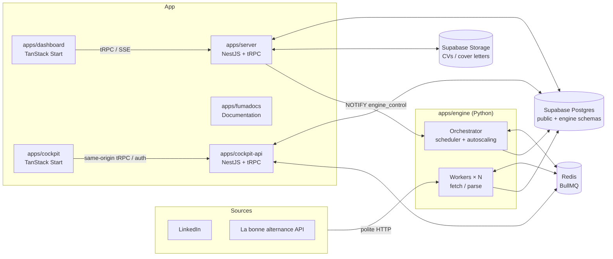

<picture>
  <source
    media="(prefers-color-scheme: dark)"
    srcset="/assets/projects/whoa-jobs/banners/github-readme-dark.png"
  />
  
</picture>

<h3 align="center">Toutes les offres, un seul dashboard.</h3>

Une plateforme full-stack qui collecte les offres d'alternance et de CDI de plusieurs job boards, les dédoublonne et permet de les suivre et d'y candidater depuis un seul endroit.

<a href="#fonctionnalités">Fonctionnalités</a> · <a href="#architecture">Architecture</a>

---

## À propos

Chercher une alternance ou un premier emploi, c'est consulter LinkedIn, Indeed, HelloWork et les autres tous les jours, retrouver trois fois la même offre et perdre le fil de ses candidatures.

**Whoa Jobs** règle ça avec une idée simple :

> **Ce sont les job boards qui viennent à vous, pas l'inverse.**

Un moteur de collecte en Python récupère les offres en arrière-plan, une API les normalise et les sert, et un dashboard permet aux candidats de les parcourir, les filtrer et y candidater — pendant que les admins pilotent tout le moteur en direct, sans jamais le redémarrer.

{/* 🎬 PLACEHOLDER — Vidéo de démo principale (30–90 s) : connexion → liste des offres → filtres → auto-candidature */}

---

## ✨ Fonctionnalités

### 🔎 Un flux d'offres unique

Toutes les sources dans une seule liste, avec recherche et filtres par source, lieu, type de contrat et date.

Quand une même offre apparaît sur plusieurs sites, elle est **regroupée entre les sources** au lieu de s'afficher trois fois.

<Screenshots
  items={[
    {
      light: '/assets/projects/whoa-jobs/app-light/04-jobs.png',
      dark: '/assets/projects/whoa-jobs/app-dark/04-jobs.png',
      alt: 'Liste des offres',
      caption: 'Flux unifié · recherche & filtres',
    },
  ]}
/>

---

### 📄 Documents

Le CV et la lettre de motivation sont envoyés une seule fois, stockés dans un bucket privé et prévisualisés directement dans la barre latérale (PDF et DOCX).

<Screenshots
  items={[
    {
      light: '/assets/projects/whoa-jobs/app-light/05-documents.png',
      dark: '/assets/projects/whoa-jobs/app-dark/05-documents.png',
      alt: 'Documents',
      caption: 'Documents · CV & lettre de motivation',
    },
  ]}
/>

---

### 🚀 Auto-candidature

Un clic retrouve où l'offre accepte les candidatures, vérifie les documents et les envoie — avec une garde atomique pour qu'une candidature ne parte jamais deux fois, et une reprise en cas d'échec.

---

### 🔔 Notifications en temps réel

Les notifications arrivent dans le dashboard via SSE dès qu'elles sont enregistrées dans Postgres (`LISTEN/NOTIFY`), avec niveaux d'importance et statut lu/non lu.

---

### 🏢 Espaces de travail & équipes

Entreprises, invitations, équipes, rôles des membres et personnalisation de l'apparence — construits sur les organisations Better Auth.

---

### 🎛️ Salle de contrôle du moteur

Les super-admins disposent d'une vraie salle de contrôle pour le moteur de collecte :

- **Live ops** — profondeur des files, workers actifs vs cible, requêtes par minute, taux d'erreur, état du disjoncteur
- **Réglages à chaud** — activer le moteur ou une source, « Run now », ajuster limites de débit et mise à l'échelle, le tout appliqué **en quelques secondes, sans redémarrage**
- **Cron jobs & logs** — planifications et événements alimentés par les vraies données du moteur
- **Audit, impersonation & broadcast** — chaque action sensible tracée, « voir en tant que » un utilisateur, notifier tout le monde

<Screenshots
  items={[
    {
      light: '/assets/projects/whoa-jobs/app-light/02-system-status.png',
      dark: '/assets/projects/whoa-jobs/app-dark/02-system-status.png',
      alt: 'État du système',
      caption: 'Salle de contrôle · état du système',
    },
  ]}
/>

{/* 🎬 PLACEHOLDER — GIF court : activer un driver, « Run now », les files se remplissent dans Live ops */}

<Screenshots
  items={[
    {
      light: '/assets/projects/whoa-jobs/engine-run-now.gif',
      dark: '/assets/projects/whoa-jobs/engine-run-now.gif',
      alt: 'Run now depuis le dashboard',
      caption: 'Run now depuis le dashboard',
    },
  ]}
/>

---

## 🧱 Architecture

<Files>
  <Folder name="whoa-jobs" defaultOpen>
    <Folder name="apps" defaultOpen>
      <File name="dashboard/ — TanStack Start front end (port 3001)" />
      <File name="server/ — NestJS API serving packages/api (port 3000)" />
      <File name="cockpit/ — Separate platform-operations UI (port 3003 in dev)" />
      <File name="cockpit-api/ — Cockpit auth and operations API (port 3002 in dev)" />
      <File name="engine/ — Python ingestion engine (BullMQ + Redis)" />
      <File name="fumadocs/ — Product docs, releases and content APIs (port 4000)" />
    </Folder>
    <Folder name="packages" defaultOpen>
      <File name="api/ — tRPC routers, middlewares, Zod schemas, business logic" />
      <File name="auth/ — Better Auth configuration" />
      <File name="db/ — Prisma schema, migrations, seeds, Supabase config" />
      <File name="shared/ — Shared contracts and server utilities" />
      <File name="ui/ — Shared shadcn/ui components + global styles" />
      <File name="config/ — Shared base tsconfig" />
    </Folder>
    <Folder name="deploy/cockpit/">
      <File name="Cockpit proxy, Redis ACL and verification" />
    </Folder>
    <File name="docker-compose.yml — User-facing app, Redis and engine" />
    <File name="docker-compose.cockpit.yml — Hardened Cockpit, engine and tunnel stack" />
    <File name="docker-compose.local.yml — Optional Caddy proxy (HTTPS on *.whoa-jobs.localtest.me)" />
    <File name="Caddyfile" />
  </Folder>
</Files>

---

## 🕷️ Le moteur de collecte

La partie la plus intéressante du projet. C'est un collecteur **scalable horizontalement** et **poli par conception** :

- **Files de tâches sur Redis (BullMQ)** — une tâche = une recherche ou une offre. Livraison « au moins une fois », upserts idempotents, clés de déduplication : une tâche rejouée ne crée jamais de doublon.
- **Autoscaling** — l'orchestrateur dimensionne le pool de workers selon la profondeur des files, en processus locaux, conteneurs Docker ou réplicas fixes.
- **Un seul client poli, partagé** — `robots.txt`, token bucket global plafonné en dur à 2 req/s, concurrence par domaine, disjoncteur commun à tous les workers, backoff exponentiel avec gigue, User-Agent honnête.
- **Aucun contournement, jamais** — pas de rotation de proxy, pas d'usurpation d'empreinte, pas de résolution de captcha. Une source bloquée est **mise en pause** et signalée dans le dashboard, jamais contournée.
- **Pages brutes conservées** — les parsers peuvent être relancés sur tout ce qui a déjà été téléchargé, sans une seule requête réseau.
- **Configuration à chaud** — réglages runtime validés des deux côtés (API et moteur) contre une seule spec JSON, rechargés via `NOTIFY` Postgres.

---

## 🛠️ Stack technique

<TechStack
  groups={[
    { layer: 'Monorepo', items: ['Nx 23', 'Bun 1.4 (workspaces + catalog)', 'uv (Python)'] },
    {
      layer: 'Dashboard',
      items: [
        'TanStack Start',
        'TanStack Router',
        'TanStack Query',
        'TanStack Form',
        'TanStack Table',
        'React 19',
        'Tailwind CSS 4',
        'shadcn/ui',
        'Motion',
        'Recharts',
      ],
    },
    { layer: 'API', items: ['NestJS 11', 'tRPC 11 (nestjs-trpc)', 'Zod 4', 'evlog'] },
    {
      layer: 'Cockpit',
      items: ['TanStack Start (front end)', 'NestJS + tRPC API', 'Platform operations'],
    },
    {
      layer: 'Auth',
      items: ['Better Auth', 'Organizations', 'Teams', 'Admin', 'Impersonation'],
    },
    {
      layer: 'Database',
      items: ['PostgreSQL (Supabase)', 'Prisma (multi-file schema)', 'public & engine schemas'],
    },
    { layer: 'Storage', items: ['Supabase Storage', 'Private user-documents bucket'] },
    {
      layer: 'Ingestion engine',
      items: [
        'Python 3.12',
        'BullMQ',
        'Redis',
        'httpx',
        'SQLAlchemy (async)',
        'BeautifulSoup / lxml',
        'Typer',
        'Pydantic',
      ],
    },
    { layer: 'Documentation', items: ['Fumadocs (Next.js)'] },
    {
      layer: 'Quality',
      items: [
        'Oxlint + Oxfmt',
        'Husky + lint-staged',
        'Jest / bun test',
        'pytest',
        'Ruff',
        'mypy (strict)',
      ],
    },
    { layer: 'Config', items: ['Varlock', 'Typed .env.schema → src/env.ts'] },
  ]}
/>

---

## 💡 Ce que j'en retiens

- **Concevoir un système distribué qui reste poli.** Ajouter des workers est facile ; garantir que dix workers envoient toujours moins de requêtes qu'un humain attentif, c'est là le vrai défi — d'où des limites de débit et un disjoncteur partagés via Redis plutôt que par processus.
- **Faire partager une seule source de vérité à un service Python et une API TypeScript.** Le schéma de base appartient à Prisma, le moteur ne fait que le refléter ; les réglages runtime sont validés contre la même spec JSON des deux côtés.
- **Modifier un système en marche sans risque.** Chaque changement de réglage est validé, audité et appliqué en direct via `LISTEN/NOTIFY`, avec une relecture périodique si une notification se perd.
- **Traiter la conformité comme une fonctionnalité.** Le respect des conditions de chaque site a autant façonné l'architecture que la performance.

---

## 📸 Captures d'écran

<Screenshots
  items={[
    {
      light: '/assets/projects/whoa-jobs/app-light/07-workspace-branding.png',
      dark: '/assets/projects/whoa-jobs/app-dark/07-workspace-branding.png',
      alt: "Personnalisation de l'espace de travail",
      caption: 'Espace de travail · apparence',
    },
    {
      light: '/assets/projects/whoa-jobs/app-light/08-workspace-team.png',
      dark: '/assets/projects/whoa-jobs/app-dark/08-workspace-team.png',
      alt: "Équipe de l'espace de travail",
      caption: 'Équipes & rôles',
    },
    {
      light: '/assets/projects/whoa-jobs/app-light/13-settings-pipeline.png',
      dark: '/assets/projects/whoa-jobs/app-dark/13-settings-pipeline.png',
      alt: 'Réglages du pipeline de collecte',
      caption: 'Réglages du pipeline',
    },
    {
      light: '/assets/projects/whoa-jobs/app-light/14-notifications.png',
      dark: '/assets/projects/whoa-jobs/app-dark/14-notifications.png',
      alt: 'Notifications en temps réel',
      caption: 'Notifications',
    },
  ]}
/>

---

## 🛣️ Roadmap

- [x] Moteur de collecte (LinkedIn, Indeed, HelloWork)
- [x] Dédoublonnage inter-sources
- [x] Salle de contrôle du moteur (live ops, réglages à chaud, logs, cron)
- [x] Documents avec aperçu
- [x] Notifications en temps réel
- [ ] Envoi des auto-candidatures par source
- [ ] Synchronisation e-mail pour suivre les réponses
- [ ] Davantage de job boards
- [ ] Autoscaling Kubernetes (KEDA)
