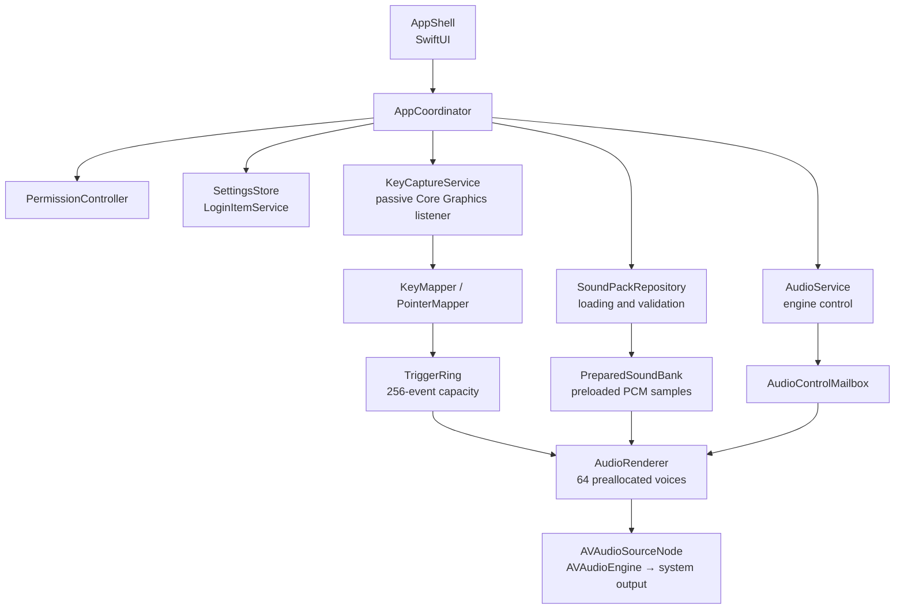

<picture>
  
</picture>

<h3 align="center">Character in every keystroke.</h3>

A utility for macOS 26.5 and later that gives your keyboard, mouse, and trackpad a voice. Everything lives in the menu bar, with 38 built-in sound packs.

<a href="#features">Features</a> · <a href="#architecture">Architecture</a>

---

## About

Part of the appeal of a mechanical keyboard is its sound: a deeper key, a heavier space bar, a little texture with every press.

**Whoa Type** brings that idea to a native app. Choose a sound, adjust the volume, and let the app accompany each press and release.

Everything runs locally: no account, no network service, and no recording of typed text. Global input monitoring requires permission from macOS. Sound is off on first launch.

{/* 🎬 PLACEHOLDER — Demo with audio: choose a pack → preview → type → click */}

---

## ✨ Features

### ⌨️ A different feel across the keyboard

Sound plays on both press and release. Automatic repeats from holding a key are ignored.

Space, Return, and Delete carry more weight; modifier keys sound lighter. Across the keyboard, the sound shifts from warmer and deeper on the left to brighter and higher on the right, with matching stereo placement.

Physical **ANSI, ISO, and JIS** keyboard geometries are selectable in Settings.

### 🎛️ 38 packs with previews

The built-in library lets you hear a pack before selecting it. Preview uses the same engine as live typing and works without Input Monitoring permission, or while Sound is off. It follows your volume setting.

Pack names describe the recordings rather than identifying switch hardware. In this initial library, each pack reuses the same keyboard recording for press and release; differences between keys come from audio processing.

{/* 🎬 PLACEHOLDER — Light and dark screenshots of the sound library */}

<Screenshots
  items={[
    {
      light: '/assets/projects/whoa-type/app-light/01-switch-library.png',
      dark: '/assets/projects/whoa-type/app-dark/01-switch-library.png',
      alt: 'Sound pack library',
      caption: 'Library · selection and preview',
    },
  ]}
/>

### 🖱️ Mouse and trackpad clicks

Left, right, and auxiliary buttons trigger their own press and release sounds.

Six press recordings alternate randomly without immediate repeats. Mouse and trackpad share this library and use the same volume as the keyboard. Movement, scrolling, and gestures produce no sound.

### ⚙️ At home in the menu bar

Toggle sound and open Settings from the menu. A dedicated window groups playback, the sound library, permissions, and launch at login.

Volume, selected pack, keyboard geometry, and sound activation persist between launches. Closing Settings keeps the utility running.

---

## 🧱 Architecture

One application, with separate responsibilities for the interface, input capture, sound loading, and audio rendering.

<Files>
  <Folder name="whoa-type" defaultOpen>
    <Folder name="whoa-type" defaultOpen>
      <File name="whoa_typeApp.swift — Entry point and SwiftUI scenes" />
      <File name="App/ — Application coordination and state" />
      <File name="AppShell/ — Menu, settings, and permission onboarding" />
      <File name="Input/ — Passive capture, keys, and buttons" />
      <File name="Permissions/ — Input Monitoring access" />
      <File name="SoundPacks/ — Manifests, validation, and PCM loading" />
      <File name="Audio/ — Bounded queues, mixing, and audio output" />
      <File name="Settings/ — Preferences and launch at login" />
      <File name="Resources/SoundPacks/ — 38 bundled packs" />
    </Folder>
    <File name="Package.swift — Testable core through Swift Package Manager" />
    <File name="Tests/WhoaTypeCoreTests/ — Swift Testing tests" />
    <File name="Tools/ — Audio preparation, probes, benchmark, and distribution" />
  </Folder>
</Files>

---

## 🧠 The core: separating input from audio rendering

Most of the work happens between a physical input and the sound it produces.

- **Passive listening.** The Core Graphics tap observes events without modifying them. Keyboard input is handled through physical key codes, without converting it to text.
- **A bounded queue.** Capture sends small audio commands through a single-producer, single-consumer queue synchronized with atomic operations. If the queue is full, the incoming sound is dropped without waiting.
- **Sounds ready before you type.** Manifests are validated, then files are decoded and converted to PCM on a dedicated queue.
- **A 64-voice mixer.** The renderer layers sounds, adjusts pitch, tone, and stereo placement, and applies fades during transitions.
- **Coordinated pack switching.** The old sound bank stays available until the renderer acknowledges the change. Preview pauses live capture, then restores the selected pack.

The app distinguishes missing permission from capture failure. macOS Secure Input contexts can suppress keyboard sounds; that boundary is respected.

---

## 🛠️ Tech stack

<TechStack
  groups={[
    {
      layer: 'Application',
      items: ['Swift', 'SwiftUI', 'Observation', 'macOS 26.5 minimum'],
    },
    {
      layer: 'Input',
      items: ['Core Graphics', 'CGEventTap (listenOnly)', 'CFRunLoop'],
    },
    {
      layer: 'Audio',
      items: ['AVFoundation', 'AVAudioEngine', 'AVAudioSourceNode', 'AVAudioConverter'],
    },
    {
      layer: 'Synchronization',
      items: ['Synchronization.Atomic', 'DispatchQueue', 'Bounded SPSC queues'],
    },
    {
      layer: 'Preferences',
      items: ['UserDefaults', 'ServiceManagement (SMAppService)'],
    },
    {
      layer: 'Quality',
      items: ['Swift Package Manager', 'Swift Testing', 'Probes and synthetic benchmark'],
    },
  ]}
/>

No third-party runtime dependencies.

---

## 💡 What I learned

- **Prepare before playing.** Decoding samples and allocating voices ahead of time keeps the rendering path short and bounded.
- **Give each queue a clear responsibility.** The interface, capture, loading, and audio control run at different rhythms. Explicit handoffs make pack changes and cancellations easier to manage.
- **Create texture from a small set of recordings.** Pitch, gain, filtering, and stereo position can give the same recording a different character.
- **Separate benchmarks from the real experience.** Synthetic tests verify the mixer; they do not measure the delay between a physical key press and the speaker. That still needs hardware validation.

---

## 📸 Screenshots

{/* 🎬 PLACEHOLDER — Light and dark screenshots of the menu and settings */}

<Screenshots
  items={[
    {
      light: '/assets/projects/whoa-type/app-light/02-menu-bar.png',
      dark: '/assets/projects/whoa-type/app-dark/02-menu-bar.png',
      alt: 'Whoa Type menu bar panel',
      caption: 'Menu · sound toggle and settings',
    },
    {
      light: '/assets/projects/whoa-type/app-light/03-playback.png',
      dark: '/assets/projects/whoa-type/app-dark/03-playback.png',
      alt: 'Playback settings',
      caption: 'Playback · volume and keyboard geometry',
    },
    {
      light: '/assets/projects/whoa-type/app-light/04-input-access.png',
      dark: '/assets/projects/whoa-type/app-dark/04-input-access.png',
      alt: 'Input permission settings',
      caption: 'Permissions · Input Monitoring',
    },
  ]}
/>

---

## 🛣️ Roadmap

- [x] SwiftUI menu bar interface
- [x] Passive keyboard and button capture
- [x] Library of 38 packs with previews
- [x] Pitch, tone, and stereo placement variations
- [x] Persistent settings and launch at login
- [x] Core tests and synthetic benchmark
- [ ] Complete permission validation in the signed app
- [ ] Validate keyboard geometries, audio devices, and sleep/wake on hardware
- [ ] Measure physical latency and complete Instruments profiling
- [ ] Add distinct keyboard release recordings
- [ ] Complete recording provenance and license documentation
- [ ] Notarize the application and publish a GitHub release
