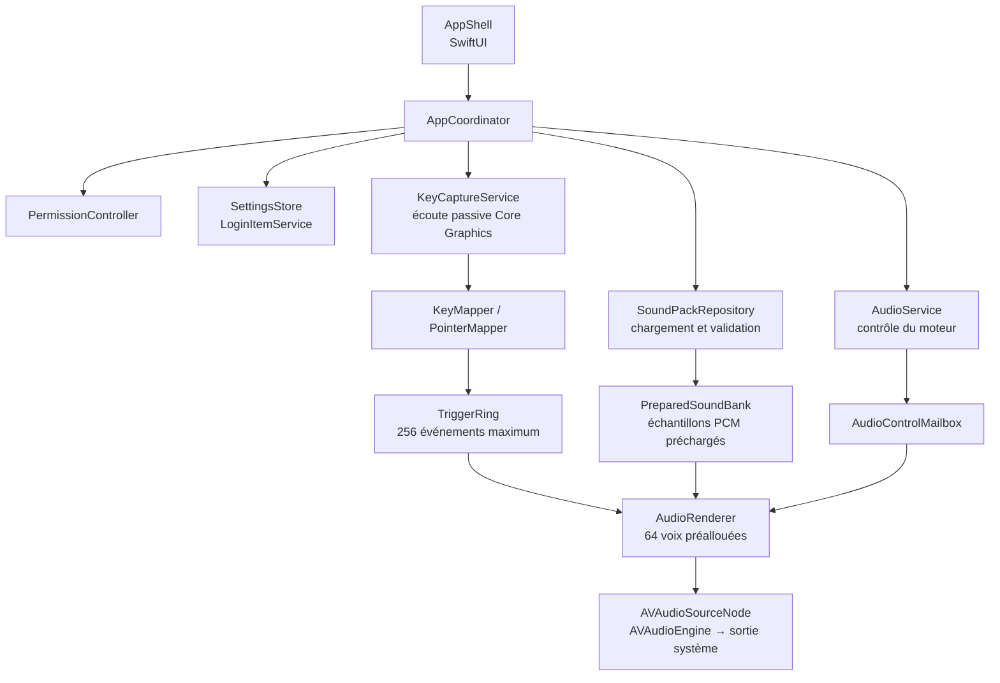

---
previews:
  [
    '/assets/projects/whoa-type/og-1200x630.png',
    '/assets/projects/whoa-type/github-social-1280x640.png',
    '/assets/projects/whoa-type/x-header-1500x500.png',
  ]
title: 'Whoa Type'
seoTitle: 'Whoa Type : sons de clavier mécanique sur macOS'
description: 'Utilitaire macOS de la barre de menus qui joue un son à chaque touche et chaque clic : 38 packs sonores, préécoute, et un moteur audio qui préalloue ses voix.'
stack: ['Swift', 'SwiftUI', 'Core Graphics', 'AVAudioEngine']
links:
  - label: 'GitHub'
    href: 'https://github.com/WhoaStudio/Whoa-Typer'
---

<picture>
  
</picture>

<h3 align="center">Du caractère dans chaque frappe.</h3>

Un utilitaire macOS qui donne une voix au clavier, à la souris et au trackpad. Tout se règle depuis la barre de menus, avec 38 packs sonores embarqués.

<a href="#fonctionnalités">Fonctionnalités</a> · <a href="#architecture">Architecture</a>

---

## À propos

Le plaisir d'un clavier mécanique tient aussi à son bruit : une touche plus grave, une barre d'espace plus marquée, un petit relief à chaque frappe.

**Whoa Type** reprend cette idée dans une app native. On choisit un pack, on règle le volume, puis l'app accompagne les appuis et les relâchements.

Le traitement reste local : pas de compte, pas de service réseau, pas d'enregistrement de ce qui est saisi. L'écoute globale demande l'autorisation de surveillance des entrées de macOS. Le son est désactivé au premier lancement.

{/* 🎬 PLACEHOLDER — Démo sonore : choix d'un pack → préécoute → frappe → clics */}

---

## ✨ Fonctionnalités

### ⌨️ Une frappe qui varie selon les touches

Un son à l'appui, un autre au relâchement. Les répétitions automatiques d'une touche maintenue sont ignorées, pour qu'un appui produise exactement un son à l'appui et un au relâchement.

Espace, Retour et Supprimer ont davantage de poids ; les touches de modification restent plus légères. De gauche à droite, le son passe d'un timbre plus chaud et grave à un rendu plus clair et aigu, avec un placement stéréo adapté à la position de la touche.

Les géométries physiques **ANSI, ISO et JIS** se choisissent dans les réglages.

---

### 🎛️ 38 packs et une préécoute

La bibliothèque embarquée permet d'écouter chaque pack avant de le sélectionner. La préécoute passe par le même moteur que la frappe, fonctionne sans autorisation de surveillance des entrées et même lorsque le son est désactivé. Elle respecte le volume choisi.

Les noms (Amber, Birch, Ember…) désignent les enregistrements, sans prétendre identifier des modèles de switches. Dans cette première bibliothèque, chaque pack réutilise le même enregistrement pour l'appui et le relâchement ; les différences entre touches sont produites par le traitement audio.

{/* 🎬 PLACEHOLDER — Captures claires et sombres de la bibliothèque */}

<Screenshots
  items={[
    {
      light: '/assets/projects/whoa-type/app-light/01-switch-library.png',
      dark: '/assets/projects/whoa-type/app-dark/01-switch-library.png',
      alt: 'Bibliothèque des packs sonores',
      caption: 'Bibliothèque · sélection et préécoute',
    },
  ]}
/>

---

### 🖱️ Des clics pour la souris et le trackpad

Les boutons gauche, droit et auxiliaires déclenchent leurs propres sons d'appui et de relâchement.

Six enregistrements d'appui alternent au hasard, sans répétition immédiate. Souris et trackpad partagent cette bibliothèque et suivent le même volume que le clavier. Les déplacements, le défilement et les gestes ne produisent aucun son, et aucune coordonnée n'est lue.

---

### ⚙️ Dans la barre de menus

Activation du son et accès aux réglages depuis le menu. Pas d'icône dans le Dock. Une fenêtre de réglages regroupe la lecture (volume, géométrie), la bibliothèque, les autorisations et le démarrage à la connexion.

Le volume, le pack choisi, la géométrie du clavier et l'état du son sont conservés entre les lancements. Fermer les réglages laisse l'utilitaire actif.

{/* 🎬 PLACEHOLDER — Captures claires et sombres du menu et des réglages */}

---

## 🧱 Architecture

Une seule application, avec des responsabilités séparées pour l'interface, la capture des entrées, le chargement des sons et le rendu audio.

<Files>
  <Folder name="whoa-type" defaultOpen>
    <Folder name="whoa-type" defaultOpen>
      <File name="whoa_typeApp.swift — Point d'entrée et scènes SwiftUI" />
      <File name="App/ — Coordination et état de l'application" />
      <File name="AppShell/ — Menu, réglages et parcours d'autorisation" />
      <File name="Input/ — Capture passive, touches et boutons" />
      <File name="Permissions/ — Accès à la surveillance des entrées" />
      <File name="SoundPacks/ — Manifestes, validation et chargement PCM" />
      <File name="Audio/ — Files bornées, mixage et sortie audio" />
      <File name="Settings/ — Préférences et lancement à la connexion" />
      <File name="Resources/SoundPacks/ — 38 packs embarqués" />
    </Folder>
    <File name="Package.swift — Cœur testable avec Swift Package Manager" />
    <File name="Tests/WhoaTypeCoreTests/ — Tests Swift Testing" />
    <File name="Tools/ — Préparation audio, sondes, benchmark et distribution" />
  </Folder>
</Files>

---

## 🧠 Le core : séparer la frappe du rendu audio

Le travail principal se trouve dans le chemin entre une touche physique et le son joué.

- **Une écoute passive.** Le tap Core Graphics (`listenOnly`) observe les événements sans les modifier. Le clavier est traité par codes physiques, sans conversion en texte.
- **Une file bornée.** La capture transmet de petites commandes audio à une file à producteur et consommateur uniques, synchronisée par opérations atomiques. Si elle est pleine, le son entrant est abandonné sans jamais bloquer la saisie.
- **Des sons prêts avant la frappe.** Les manifestes sont validés, puis les fichiers décodés et convertis en PCM sur une file dédiée, hors du chemin de rendu.
- **Un mixeur à 64 voix.** Le rendu superpose les sons, ajuste leur hauteur, leur timbre et leur placement stéréo, avec des fondus pour les transitions.
- **Un changement de pack coordonné.** L'ancienne banque reste disponible jusqu'à l'acquittement du moteur. La préécoute suspend la capture réelle, puis restaure le pack sélectionné.

L'app distingue une autorisation manquante d'un échec de capture. Les contextes de saisie sécurisée de macOS peuvent suspendre les sons ; cette protection est respectée, pas contournée.

---

## 🛠️ Stack technique

<TechStack
  groups={[
    {
      layer: 'Application',
      items: ['Swift 6', 'SwiftUI (MenuBarExtra)', 'Observation', 'macOS 26.5 minimum'],
    },
    {
      layer: 'Entrées',
      items: ['Core Graphics', 'CGEventTap (listenOnly)', 'CFRunLoop'],
    },
    {
      layer: 'Audio',
      items: ['AVFoundation', 'AVAudioEngine', 'AVAudioSourceNode', 'AVAudioConverter'],
    },
    {
      layer: 'Synchronisation',
      items: ['Synchronization (atomiques)', 'DispatchQueue', 'Files SPSC bornées'],
    },
    {
      layer: 'Préférences',
      items: ['UserDefaults', 'ServiceManagement (SMAppService)'],
    },
    {
      layer: 'Outillage',
      items: [
        'Swift Package Manager',
        'Swift Testing',
        'Script afconvert',
        'Benchmark synthétique',
      ],
    },
  ]}
/>

Aucune dépendance tierce à l'exécution.

---

## 💡 Ce que j'en retiens

- **Préparer avant de jouer.** Décoder les sons et réserver les voix en amont garde le chemin de rendu court et borné.
- **Donner une responsabilité à chaque file.** Interface, capture, chargement et contrôle audio ont des rythmes différents. Des échanges explicites rendent les changements de pack et les annulations plus faciles à maîtriser.
- **Créer du relief avec peu de matière.** Un même enregistrement change de caractère avec la hauteur, le gain, le timbre et la position stéréo.
- **Séparer le benchmark de l'expérience réelle.** Les tests synthétiques vérifient le mixeur ; ils ne mesurent pas le délai entre une touche physique et le haut-parleur. Cette mesure reste à faire sur le matériel.

---

## 📸 Captures d'écran

{/* 🎬 PLACEHOLDER — Captures claires et sombres du menu et des réglages */}

<Screenshots
  items={[
    {
      light: '/assets/projects/whoa-type/app-light/02-menu-bar.png',
      dark: '/assets/projects/whoa-type/app-dark/02-menu-bar.png',
      alt: 'Menu de Whoa Type dans la barre de menus',
      caption: 'Menu · activation et accès aux réglages',
    },
    {
      light: '/assets/projects/whoa-type/app-light/03-playback.png',
      dark: '/assets/projects/whoa-type/app-dark/03-playback.png',
      alt: 'Réglages de lecture',
      caption: 'Lecture · volume et géométrie du clavier',
    },
    {
      light: '/assets/projects/whoa-type/app-light/04-input-access.png',
      dark: '/assets/projects/whoa-type/app-dark/04-input-access.png',
      alt: 'Réglages des autorisations',
      caption: 'Autorisations · surveillance des entrées',
    },
  ]}
/>

---

## 🛣️ Roadmap

- [x] Interface SwiftUI dans la barre de menus
- [x] Capture passive des touches et des boutons
- [x] Bibliothèque de 38 packs avec préécoute
- [x] Variations de hauteur, de timbre et de placement stéréo
- [x] Clics de souris et de trackpad, avec six appuis alternés
- [x] Réglages persistants et lancement à la connexion
- [x] Tests du cœur et benchmark synthétique
- [ ] Terminer la validation des autorisations dans l'app signée
- [ ] Valider sur matériel les géométries, les périphériques audio et la veille
- [ ] Mesurer la latence physique et compléter le profilage sous Instruments
- [ ] Ajouter des enregistrements distincts de relâchement clavier
- [ ] Compléter la provenance et les licences des enregistrements
- [ ] Notariser l'application et publier une version sur GitHub
