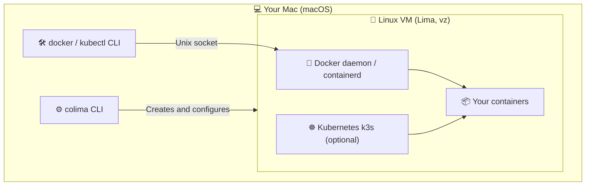

If you develop on macOS, you have almost certainly used **Docker Desktop**. It is popular, but it has grown heavy on resources, and its license is no longer free for companies with more than 250 employees or more than $10M in annual revenue.

That's where **Colima** (_Containers on Linux Machines_) comes in: an open source tool that runs Docker on a Mac without Docker Desktop, using the same `docker` commands you already know.

**In short:**

- Colima is **free and open source** (MIT license), including for companies.
- It installs with Homebrew and runs **from the command line**, with no GUI.
- Your `docker`, `docker-compose` and `kubectl` commands work **unchanged**.
- It can start a **local Kubernetes cluster (k3s)** with a single flag.

## Why choose Colima over Docker Desktop?

Colima is a lightweight command-line tool that drives a Linux virtual machine (through **Lima**) to run containers with Docker or containerd.

Its main advantages over Docker Desktop:

1. **100% free and open source**: no commercial license restrictions, unlike Docker Desktop, which requires a paid subscription above 250 employees or $10M in revenue.
2. **Lighter**: no GUI or extra background services. You allocate exactly the CPU and memory you need, and nothing runs while Colima is stopped.
3. **Fast volumes**: Colima uses macOS native virtualization (`vz`) and **virtiofs** file sharing by default, giving volume performance on par with Docker Desktop.
4. **Simple built-in Kubernetes**: a k3s cluster is one flag away at startup.
5. **Transparency and control**: you choose CPU, memory, disk size and the container runtime (`docker` or `containerd`).

## How does Colima work?

Colima relies on **Lima** (_Linux Machines_) to start a minimal Linux virtual machine on your Mac. The Docker daemon runs inside that VM, and the macOS `docker` CLI talks to it through a Unix socket.



## Install and configure Colima on macOS

### 1. Prerequisites

Colima does not ship the Docker CLI: install it separately (the CLI only, without Docker Desktop). With Homebrew:

```bash
brew install docker docker-compose
```

### 2. Install Colima

```bash
brew install colima
```

### 3. Start Colima

With the default settings (2 CPUs, 2 GB of RAM, 100 GB of disk):

```bash
colima start
```

### Recommended settings on Apple Silicon

On recent Colima versions, native virtualization (`--vm-type=vz`) and `virtiofs` file sharing are already the defaults. For heavier projects, mostly raise the resources:

```bash
colima start --cpus 4 --memory 8
```

Need to run x86 (`amd64`) images on an Apple Silicon Mac? Enable Rosetta for much faster emulation:

```bash
colima start --vz-rosetta
```

To keep these settings, edit the configuration before starting with `colima start --edit`.

## Using Colima day to day

Once Colima is running, the `docker` command works directly, with no change to your habits.

### Check the status

```bash
colima status
```

### Use Docker as usual

```bash
docker run -d -p 8080:80 nginx
docker ps
docker-compose up -d
```

### Enable Kubernetes

For a local Kubernetes environment:

```bash
colima start --kubernetes
```

Colima automatically updates your `~/.kube/config` so `kubectl` points at the cluster.

### Change the allocated resources

You can adjust the configuration at any time:

```bash
colima stop
colima start --cpus 6 --memory 12
```

### Start Colima automatically

To launch Colima when you log in:

```bash
brew services start colima
```

### Stop or delete the instance

```bash
# Stop Colima to free up RAM
colima stop

# Delete the VM and start from scratch
colima delete
```

## Migrate from Docker Desktop to Colima

1. **Quit Docker Desktop**, then uninstall it if you no longer need it.
2. **Install the Docker CLI and Colima** (see above), then run `colima start`.
3. **Check the Docker context**: Colima creates a `colima` context and switches to it automatically. Confirm with `docker context ls`, and switch back to Docker Desktop if needed with `docker context use desktop-linux`.
4. **Get your images back**: Docker Desktop images and volumes are not transferred. Run your `docker pull` or `docker-compose up` again to rebuild them.

## Docker Desktop vs Colima

| Feature             | Docker Desktop            | Colima                   |
| :------------------ | :------------------------ | :----------------------- |
| **License**         | Paid for larger companies | **Free (MIT)**           |
| **GUI**             | Yes                       | No (command line)        |
| **RAM / CPU usage** | High                      | **Low and configurable** |
| **Volumes on Mac**  | VirtioFS                  | **virtiofs by default**  |
| **Kubernetes**      | Included                  | **Included (k3s)**       |
| **Getting started** | Click through the GUI     | A few commands           |

## Frequently asked questions

### Is Colima free for commercial use?

Yes. Colima is released under the MIT license: it is free for any use, including in companies, with no subscription.

### Can I keep Docker Desktop and Colima side by side?

Yes. Each one exposes its own Docker context. Switch between them with `docker context use colima` or `docker context use desktop-linux`.

### Testcontainers or another tool can't find Docker: what should I do?

Some tools look for the Docker socket at its default location. Point them to Colima's socket:

```bash
export DOCKER_HOST="unix://${HOME}/.colima/default/docker.sock"
```

For Testcontainers, also set `TESTCONTAINERS_DOCKER_SOCKET_OVERRIDE=/var/run/docker.sock`.

### Colima or OrbStack?

OrbStack is another Docker Desktop alternative, with a GUI, but its license is paid for commercial use. Colima remains the fully free and open source option.

## Conclusion

If you don't mind working without a GUI, **Colima is one of the best Docker Desktop alternatives on macOS today**: lighter, completely free, and compatible with your existing Docker commands. Migrating takes just a few minutes.
