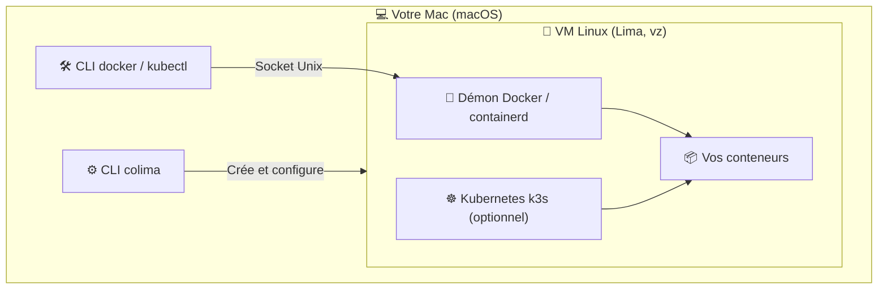

Si vous développez sur macOS, vous avez très certainement déjà utilisé **Docker Desktop**. Très populaire, il est pourtant devenu lourd en ressources, et sa licence n'est plus gratuite pour les entreprises de plus de 250 salariés ou de plus de 10 M$ de chiffre d'affaires.

C'est là qu'intervient **Colima** (_Containers on Linux Machines_) : un outil open source qui fait tourner Docker sur Mac sans Docker Desktop, avec les mêmes commandes `docker` que vous utilisez déjà.

**En bref :**

- Colima est **gratuit et open source** (licence MIT), y compris en entreprise.
- Il s'installe avec Homebrew et se pilote **en ligne de commande**, sans interface graphique.
- Vos commandes `docker`, `docker-compose` et `kubectl` fonctionnent **sans changement**.
- Il peut lancer un cluster **Kubernetes local (k3s)** avec une seule option.

## Pourquoi choisir Colima plutôt que Docker Desktop ?

Colima est un outil léger en ligne de commande qui pilote une machine virtuelle Linux (via **Lima**) pour exécuter des conteneurs avec Docker ou containerd.

Ses principaux avantages par rapport à Docker Desktop :

1. **100 % gratuit et open source** : aucune restriction de licence commerciale, contrairement à Docker Desktop qui exige un abonnement payant au-delà de 250 salariés ou 10 M$ de chiffre d'affaires.
2. **Plus léger** : pas d'interface graphique ni de services annexes en arrière-plan. Vous allouez exactement le CPU et la mémoire dont vous avez besoin, et rien ne tourne quand Colima est arrêté.
3. **Volumes rapides** : Colima utilise par défaut la virtualisation native de macOS (`vz`) et le partage de fichiers **virtiofs**, ce qui donne des performances de volumes au niveau de Docker Desktop.
4. **Kubernetes intégré et simple** : un cluster k3s s'active avec une seule option au démarrage.
5. **Transparence et contrôle** : vous choisissez le CPU, la mémoire, l'espace disque et le moteur de conteneurs (`docker` ou `containerd`).

## Comment fonctionne Colima ?

Colima s'appuie sur **Lima** (_Linux Machines_) pour lancer une machine virtuelle Linux minimale sur votre Mac. Le démon Docker tourne dans cette VM, et la CLI `docker` de macOS lui parle via un socket Unix.



## Installer et configurer Colima sur macOS

### 1. Prérequis

Colima ne fournit pas la CLI Docker : installez-la séparément (la CLI seule, sans Docker Desktop). Avec Homebrew :

```bash
brew install docker docker-compose
```

### 2. Installer Colima

```bash
brew install colima
```

### 3. Démarrer Colima

Avec les paramètres par défaut (2 CPU, 2 Go de RAM, 100 Go de disque) :

```bash
colima start
```

### Réglages recommandés sur Apple Silicon

Sur les versions récentes de Colima, la virtualisation native (`--vm-type=vz`) et le partage de fichiers `virtiofs` sont déjà activés par défaut. Pour un projet plus lourd, augmentez surtout les ressources :

```bash
colima start --cpus 4 --memory 8
```

Besoin d'exécuter des images x86 (`amd64`) sur un Mac Apple Silicon ? Activez Rosetta pour une émulation bien plus rapide :

```bash
colima start --vz-rosetta
```

Pour garder ces réglages, éditez la configuration avant le démarrage avec `colima start --edit`.

## Utiliser Colima au quotidien

Une fois Colima démarré, la commande `docker` fonctionne directement, sans rien changer à vos habitudes.

### Vérifier le statut

```bash
colima status
```

### Utiliser Docker normalement

```bash
docker run -d -p 8080:80 nginx
docker ps
docker-compose up -d
```

### Activer Kubernetes

Pour un environnement Kubernetes local :

```bash
colima start --kubernetes
```

Colima configure automatiquement votre fichier `~/.kube/config` pour que `kubectl` pointe vers le cluster.

### Modifier les ressources allouées

Vous pouvez ajuster la configuration à tout moment :

```bash
colima stop
colima start --cpus 6 --memory 12
```

### Démarrer Colima automatiquement

Pour que Colima se lance à l'ouverture de session :

```bash
brew services start colima
```

### Arrêter ou supprimer l'instance

```bash
# Arrêter Colima pour libérer la RAM
colima stop

# Supprimer la VM et repartir de zéro
colima delete
```

## Migrer de Docker Desktop vers Colima

1. **Quittez Docker Desktop**, puis désinstallez-le si vous n'en avez plus besoin.
2. **Installez la CLI Docker et Colima** (voir ci-dessus), puis lancez `colima start`.
3. **Vérifiez le contexte Docker** : Colima crée un contexte `colima` et l'active automatiquement. Contrôlez avec `docker context ls`, et revenez à Docker Desktop si besoin avec `docker context use desktop-linux`.
4. **Récupérez vos images** : les images et volumes de Docker Desktop ne sont pas transférés. Relancez vos `docker pull` ou `docker-compose up` pour les reconstruire.

## Comparatif Docker Desktop vs Colima

| Fonctionnalité          | Docker Desktop                       | Colima                     |
| :---------------------- | :----------------------------------- | :------------------------- |
| **Licence**             | Payante pour les grandes entreprises | **Gratuite (MIT)**         |
| **Interface graphique** | Oui                                  | Non (ligne de commande)    |
| **Empreinte RAM / CPU** | Élevée                               | **Faible et configurable** |
| **Volumes sur Mac**     | VirtioFS                             | **virtiofs par défaut**    |
| **Kubernetes**          | Inclus                               | **Inclus (k3s)**           |
| **Prise en main**       | Clic dans l'interface                | Quelques commandes         |

## Questions fréquentes

### Colima est-il gratuit pour un usage professionnel ?

Oui. Colima est distribué sous licence MIT : il est gratuit pour tous les usages, y compris en entreprise, sans abonnement.

### Peut-on garder Docker Desktop et Colima en parallèle ?

Oui. Chacun expose son propre contexte Docker. Passez de l'un à l'autre avec `docker context use colima` ou `docker context use desktop-linux`.

### Testcontainers ou un autre outil ne trouve pas Docker : que faire ?

Certains outils cherchent le socket Docker à son emplacement par défaut. Indiquez-leur celui de Colima :

```bash
export DOCKER_HOST="unix://${HOME}/.colima/default/docker.sock"
```

Pour Testcontainers, ajoutez aussi `TESTCONTAINERS_DOCKER_SOCKET_OVERRIDE=/var/run/docker.sock`.

### Colima ou OrbStack ?

OrbStack est une autre alternative à Docker Desktop, avec une interface graphique, mais sa licence est payante pour un usage commercial. Colima reste l'option entièrement gratuite et open source.

## Conclusion

Si l'absence d'interface graphique ne vous dérange pas, **Colima est aujourd'hui l'une des meilleures alternatives à Docker Desktop sur macOS** : plus léger, entièrement gratuit, et compatible avec vos commandes Docker existantes. Quelques minutes suffisent pour migrer.
